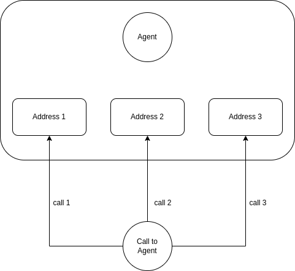

.. _agent-overview:

Overview
========

.. note:: **AI Context**

   * **Complexity:** Medium
   * **Cost:** Free (agent management operations incur no charges; calls routed to agents are billed per call minute)
   * **Async:** No. Agent CRUD operations are synchronous. However, an agent's status change to ``busy`` when a routed call is answered happens asynchronously via the call routing system.

The agent, also known as the call center agent or phone agent, plays a crucial role as a representative of a company, handling calls with private or business customers on behalf of the organization. Typically, agents work in a call center environment, where multiple agents are employed to efficiently manage incoming and outgoing calls. The call center may be operated by the company itself or outsourced to an external service provider. In the case of external service providers, a single site may serve various clients from different businesses.

In VoIPBin, agents are the people (or endpoints) that receive calls from queues. Their status and contact addresses determine when and how they can receive calls; skill tags determine which queues can route calls to them (see below).

Agent Status
------------
Every agent has a status that reflects their current availability. The status determines whether an agent can receive calls from queues.

**Status Overview**

::

    +-----------------------------------------------------------------------------+
    |                         Agent Status States                              |
    +-----------------------------------------------------------------------------+

                      +-------------------------------------------+
                      |              User Actions                  |
                      |   (Agent manually changes their status)    |
                      +---------------------+---------------------+
                                          |
              +---------------------------+---------------------------+
              |                           |                           |
              v                           v                           v
        +-----------+              +-----------+              +-----------+
        | available |              |   away    |              |  offline  |
        | (ready)   |              | (break)   |              |(logged out)|
        +-----+-----+              +-----------+              +-----------+
              |
              | Routed call answered
              v
        +-----------+
        |   busy    |
        | (on call) |
        +-----+-----+
              |
              | Call ends
              v
        (stays "busy" until the agent
         manually sets a new status)

**Status Descriptions**

+-----------+-----------------------------------------------------------------+------------------+
| Status    | What it means                                                   | Can receive      |
|           |                                                                 | queue calls?     |
+===========+=================================================================+==================+
| available | Agent is logged in and ready to take calls                      | Yes              |
+-----------+-----------------------------------------------------------------+------------------+
| away      | Agent is temporarily unavailable (break, meeting, etc.)         | No               |
+-----------+-----------------------------------------------------------------+------------------+
| busy      | Agent is currently handling a call                              | No               |
+-----------+-----------------------------------------------------------------+------------------+
| offline   | Agent is logged out of the system                               | No               |
+-----------+-----------------------------------------------------------------+------------------+

**Status Transitions**

::

    Manual transitions (agent controls):
    +-----------+ <--------------------------------> +-----------+
    | available |          User changes status       |   away    |
    +-----------+ <--------------------------------> +-----------+
          ^                                                ^
          |              User logs in/out                  |
          v                                                v
    +-----------+ <--------------------------------> +-----------+
    |  offline  |                                    |  offline  |
    +-----------+                                    +-----------+

    Automatic transitions (system controls):
    +-----------+   Routed call answered    +-----------+
    | available |-------------------------->|   busy    |
    +-----------+                           +-----------+

    Note: during dial (before the call is answered) the agent is temporarily
    excluded from re-selection by an internal reservation, not by a status
    change, so the status stays "available" until the call is answered.

    Note: there is no automatic transition back to "available" when the
    call ends. The agent (or your application) must explicitly call
    PUT /agents/{id}/status to become eligible for queue calls again.

Agent Tags (Skills)
-------------------
Tags define what skills or groups an agent belongs to, and are used for skill-based routing from queues.

**How Tags Work**

::

    +-----------------------------------------------------------------------------+
    |                         Skill-Based Routing                              |
    +-----------------------------------------------------------------------------+

    Agent Tags:                              Queue Requirements:
    +-------------------------+             +-------------------------+
    | Agent Smith             |             | Support Queue           |
    | Tags:                   |             | Required Tags:          |
    |  o english              |             |  o english              |
    |  o billing              |             |  o billing              |
    |  o vip_support          |             +-------------------------+
    +-------------------------+                        |
              |                                        |
              +--------------------+-------------------+
                                   |
                                   v
                          +-------------------+
                          | Agent is eligible  |
                          | if it has ANY tag  |
                          | in common with the |
                          | queue's tag_ids.   |
                          +-------------------+

**Tag Field**

- ``GET /agents?tag_ids=<comma-separated-tag-ids>`` filters server-side: only agents whose ``tag_ids`` array contains at least one of the given ids are returned. An empty ``tag_ids`` query parameter (present but with no value) is rejected as invalid input.
- A queue whose own ``tag_ids`` is empty applies no tag constraint at all -- routing considers every available agent belonging to the queue's customer, tagged or not. This preserves the behavior existing queues rely on when they don't use skill-based routing.
- A queue with a non-empty ``tag_ids`` only considers agents that share **at least one** tag with the queue (an overlap/"any of" match, not "all of").
- Tags can represent anything: languages, skills, departments, locations.

::

    Example Tag Structure:
    +-----------------------------------------------------------------------------+
    |                                                                          |
    |  Language Tags:     english, spanish, french, german                    |
    |                                                                          |
    |  Skill Tags:        billing, tech_support, sales, returns               |
    |                                                                          |
    |  Tier Tags:         tier1, tier2, supervisor, manager                   |
    |                                                                          |
    |  Department Tags:   customer_service, operations, hr                    |
    |                                                                          |
    +-----------------------------------------------------------------------------+

**Managing Agent Tags**

Update an agent's tags via the API:

.. code::

    $ curl -X PUT 'https://api.voipbin.net/v1.0/agents/<agent-id>/tag_ids?token=<token>' \
        --header 'Content-Type: application/json' \
        --data '{
            "tag_ids": [
                "uuid-for-english-tag",
                "uuid-for-billing-tag",
                "uuid-for-tier2-tag"
            ]
        }'

Contact Addresses
-----------------
Each agent can have multiple contact addresses - these are the endpoints where calls are delivered when the agent is selected.

**Address Types**

::

    +-----------------------------------------------------------------------------+
    |                        Agent Contact Addresses                           |
    +-----------------------------------------------------------------------------+

    Agent: John Smith
    +-----------------------------------------------------------------------------+
    | Addresses:                                                               |
    |                                                                          |
    |  1. Extension: 1001                                                     |
    |     -> Rings desk phone registered to extension 1001                     |
    |                                                                          |
    |  2. Tel: +14155551234                                                   |
    |     -> Rings mobile phone at this number                                 |
    |                                                                          |
    |  3. SIP: john@company.com                                               |
    |     -> Rings SIP softphone client                                        |
    |                                                                          |
    +-----------------------------------------------------------------------------+

+------------+----------------------------------------------------------------+
| Type       | Description                                                    |
+============+================================================================+
| extension  | Extension (UUID) registered with VoIPBin, assigned by an admin |
+------------+----------------------------------------------------------------+
| tel        | External phone number in E.164 format (+15551234567)           |
+------------+----------------------------------------------------------------+
| sip        | Direct SIP address (user@domain)                               |
+------------+----------------------------------------------------------------+

.. note:: **AI Implementation Hint**

   When setting agent addresses of type ``tel``, the number must be in E.164 format: start with ``+``, followed by country code and number, no dashes or spaces (e.g., ``+15551234567``). A ``tel`` address must contain at least one digit. For ``extension`` type, use the extension id (UUID). It is stored in the canonical form (lowercase, hyphenated). The ``extension`` addresses can only be assigned by a customer admin or manager, through ``PUT /agents/{id}/addresses`` or when creating the agent with ``POST /agents``. An agent cannot add or change an ``extension`` address of its own.

**Address Uniqueness**

Each address can only belong to one agent per customer:

::

    ✓ Agent A has extension (UUID) E1 in Customer X
    ✓ Agent B has extension (UUID) E1 in Customer Y  (different customer, OK)
    ✗ Agent B has extension (UUID) E1 in Customer X  (same customer, CONFLICT)

Push Devices
------------
An agent can register the push token of its mobile app, so that VoIPbin can notify the app. The registration is private to the agent and exists only on the agent surface (``/service_agents/*``). The owner of a device is always the authenticated agent; it is never taken from the request.

+--------+----------------------------------------+-------------------------------------------------------------------------------------------+
| Method | Endpoint                               | Description                                                                               |
+========+========================================+===========================================================================================+
| POST   | ``/service_agents/push_devices``       | Register the push device, or refresh it when the same token is already registered.        |
+--------+----------------------------------------+-------------------------------------------------------------------------------------------+
| DELETE | ``/service_agents/push_devices/{id}``  | Delete one of the calling agent's push devices.                                           |
+--------+----------------------------------------+-------------------------------------------------------------------------------------------+

The request body of ``POST /service_agents/push_devices`` has two fields:

* ``platform`` (enum string): The platform of the app. Only ``android`` is supported.
* ``token`` (String): The push token issued to the app by the platform's push service. 1 to 512 bytes.

Registering returns ``200`` with the device both for a new device and for a refreshed one. A token that was registered by another agent moves to the calling agent. The response never contains the token. An unsupported ``platform``, or an empty or longer than 512 bytes ``token``, returns ``400``.

``DELETE /service_agents/push_devices/{id}`` returns the deleted device. A device that does not exist, or that belongs to another agent or another customer, is reported identically as ``404 DEVICE_NOT_FOUND``.

See :ref:`Push device struct <agent-struct-agent-push_device>` for the response fields.

.. note:: **AI Implementation Hint**

   Both endpoints need an agent token (a token of a signed-in agent). An access key or any other non-agent token gets ``401``. The ``id`` for the delete call is the ``id`` returned by ``POST /service_agents/push_devices``. The push token is a credential: store it only on the device and never log it.

Push Notification Settings
--------------------------
The app of an agent is notified by a push when a call comes in and, from the events of the platform, when a chat mentions the agent, a chat message arrives, a customer message arrives in a conversation the agent owns, a case is assigned to the agent, or another agent writes a note on a case the agent owns. The agent chooses which of these kinds it receives and which chats it mutes. The settings belong to the authenticated agent and are never taken from the request.

+--------+-------------------------------------------------+--------------------------------------------------------------------------+
| Method | Endpoint                                        | Description                                                              |
+========+=================================================+==========================================================================+
| GET    | ``/service_agents/me/push_settings``            | Get the kinds that are on or off and the muted chats.                    |
+--------+-------------------------------------------------+--------------------------------------------------------------------------+
| PUT    | ``/service_agents/me/push_settings``            | Switch kinds on or off.                                                  |
+--------+-------------------------------------------------+--------------------------------------------------------------------------+
| PUT    | ``/service_agents/me/push_mutes/{chat_id}``     | Mute a chat.                                                             |
+--------+-------------------------------------------------+--------------------------------------------------------------------------+
| DELETE | ``/service_agents/me/push_mutes/{chat_id}``     | Unmute a chat.                                                           |
+--------+-------------------------------------------------+--------------------------------------------------------------------------+

Everything is on and nothing is muted until the agent changes it. The kinds that can be switched are ``chat_mentioned``, ``chat_message``, ``conversation_message``, ``case_assigned`` and ``case_note``; the incoming call notification cannot be switched off. All four calls return the settings after the change (see :ref:`Push settings struct <agent-struct-agent-push_settings>`).

* ``PUT /service_agents/me/push_settings`` takes ``kinds``, an object whose key is a kind and whose value is ``true`` (on) or ``false`` (off). A kind that is not in ``kinds`` is not changed and an empty ``kinds`` changes nothing. A key that is not a switchable kind returns ``400 INVALID_KIND`` before anything is changed. The kinds are written one by one: when a write fails the call returns a ``5xx`` error and the kinds written before stay changed, so send the same request again. The call is idempotent.
* ``PUT /service_agents/me/push_mutes/{chat_id}`` mutes the chat: the ``chat_message`` notifications of the chat stop, while a mention of the agent in it (``chat_mentioned``) is still delivered. The chat must belong to the customer of the agent; the agent does not have to be a participant. A chat that does not exist, that belongs to another customer or that cannot be read returns ``404 CHAT_NOT_FOUND``. Muting a muted chat returns ``200``.
* ``DELETE /service_agents/me/push_mutes/{chat_id}`` unmutes the chat and returns ``200`` also when the chat was not muted.

``chat_message`` goes to the agents who take part in the chat, except the author and the agents mentioned in the message: one message gives an agent one notification at most. An agent who switched ``chat_mentioned`` off gets no notification for a message that mentions him, even when ``chat_message`` is on. A notification carries ids only (for example the chat and the message), never the text.

.. note:: **AI Implementation Hint**

   These endpoints need an agent token (a token of a signed-in agent). An access key or any other non-agent token gets ``401``. The ``chat_id`` is the chat ``id`` returned by ``GET /service_agents/talk_chats``. Settings can be sent before any push device is registered.

Call to agent
-------------
To reach an agent, VoIPBin employs a system that allows the agent to have multiple addresses. When a call is initiated to agents, VoIPBin generates calls to every agent's address simultaneously. If an agent answers one of the calls, VoIPBin automatically terminates the other calls, streamlining the communication process and ensuring that only one connection is established with the available agent.

**Simultaneous Ring**

::

    +-----------------------------------------------------------------------------+
    |                      Agent with Multiple Addresses                       |
    +-----------------------------------------------------------------------------+

    Queue finds Agent Smith (available)
                   |
                   v
    +------------------------------+
    |  Ring ALL addresses at once  |
    +------------------------------+
                   |
         +---------+---------+
         v         v         v
    +---------+ +---------+ +---------+
    | Ext 1001| | Mobile  | | SIP App |
    |  RING!  | |  RING!  | |  RING!  |
    +----+----+ +----+----+ +----+----+
         |          |          |
         |          |          | Agent answers on mobile!
         |          |          v
         |          |    +-----------+
         |          |    | CONNECTED |
         |          |    +-----------+
         |          |
         v          v
    +---------+ +---------+
    | CANCEL  | | CANCEL  |  <- Other calls automatically cancelled
    +---------+ +---------+

This approach enables efficient call handling, minimizing the time customers spend waiting for an available agent. The call distribution mechanism ensures that agents are optimally utilized, enhancing customer service and overall call center productivity.

Agent Lifecycle
---------------
Understanding the agent lifecycle helps you manage your call center effectively.

**Creating an Agent**

::

    +-----------------------------------------------------------------------------+
    |                         Agent Creation                                   |
    +-----------------------------------------------------------------------------+

    POST https://api.voipbin.net/v1.0/agents
    +---------------------------------------+
    | {                                     |
    |   "username": "john@company.com",     |
    |   "password": "secure_password",      |
    |   "name": "John Smith",               |
    |   "tag_ids": [...],                   |
    |   "addresses": [...]                  |
    | }                                     |
    +---------------------------------------+
                     |
                     v
    +---------------------------------------+
    | Agent Created                         |
    | o Status: offline (default)           |
    | o Permission: user (default)          |
    | o Ready to be configured              |
    +---------------------------------------+

**Agent Login Flow**

::

    +-----------------------------------------------------------------------------+
    |                          Agent Login                                     |
    +-----------------------------------------------------------------------------+

    1. Agent calls login API
       POST https://api.voipbin.net/v1.0/login
       { "username": "...", "password": "..." }
              |
              v
    2. System validates credentials
       +----------------+
       | Check password |
       | hash in DB     |
       +----------------+
              |
              v
    3. Return agent info
       +------------------------------------+
       | {                                  |
       |   "id": "agent-uuid",              |
       |   "name": "John Smith",            |
       |   "status": "offline",             |
       |   "permission": "user",            |
       |   ...                              |
       | }                                  |
       +------------------------------------+
              |
              v
    4. Agent sets status to "available"
       PUT https://api.voipbin.net/v1.0/agents/{id}/status
       { "status": "available" }
              |
              v
    5. Agent is now ready to receive calls!

**Guest Agent**

Every customer account automatically has a guest agent created:

::

    +-----------------------------------------------------------------------------+
    |                          Guest Agent                                     |
    +-----------------------------------------------------------------------------+

    o Created automatically when customer account is created
    o Has admin permissions
    o Cannot be deleted
    o Cannot have password changed
    o Ensures account always has at least one admin
    o Deleting or demoting the last admin of a customer is rejected with 409 AGENT_LAST_ADMIN

How Agents Receive Queue Calls
------------------------------
The complete flow of how a call is routed from a queue to an agent:

::

    +-----------------------------------------------------------------------------+
    |                    Queue to Agent Call Flow                              |
    +-----------------------------------------------------------------------------+

    Step 1: Call waiting in queue
    +----------------------+
    | Queuecall: waiting   |
    | Queue: Support       |
    | Required tags:       |
    |  o english           |
    |  o billing           |
    +----------+-----------+
               |
               v
    Step 2: Queue searches for agents
    +----------------------------------------------------------------------+
    | SELECT agents WHERE:                                                  |
    |   o customer_id = queue's customer_id                                |
    |   o status = 'available'                                             |
    |   o tag_ids overlaps queue's tag_ids (skipped if the queue has no    |
    |     tags -- see the Queue Overview)                                  |
    +----------------------------------------------------------------------+
               |
               v
    Step 3: Select one matching agent (random)
    +----------------------------------------------------------------------+
    | Found: Agent A, Agent C, Agent E                                      |
    | Selected: Agent C (random)                                            |
    +----------------------------------------------------------------------+
               |
               v
    Step 4: Route call to agent
    +----------------------+
    | Agent C status:      |
    | available (reserved  |
    | during dial)         |
    +----------+-----------+
               |
               | Agent's phones ring
               v
    Step 5: Agent answers
    +----------------------+
    | Agent C status:      |
    | available -> busy     |
    |                      |
    | Queuecall status:    |
    | waiting -> service    |
    +----------------------+

Status Events and Webhooks
--------------------------
Agent status changes trigger events that you can subscribe to:

::

    +-----------------------------------------------------------------------------+
    |                      Agent Status Events                                 |
    +-----------------------------------------------------------------------------+

    Agent changes status
           |
           v
    +----------------------+
    | agent_status_updated |
    | event generated      |
    +----------+-----------+
               |
               +-----------------------------------------+
               |                                         |
               v                                         v
    +----------------------+              +----------------------+
    | Webhook notification |              | Internal event       |
    | to your endpoint     |              | (other services)     |
    +----------------------+              +----------------------+

**Example Webhook Payload**

::

    {
        "event_type": "agent_status_updated",
        "data": {
            "id": "agent-uuid",
            "customer_id": "customer-uuid",
            "username": "john@company.com",
            "name": "John Smith",
            "status": "available",
            "tm_update": "2024-01-15T10:30:00Z"
        }
    }

Permission
----------
In the VoIPBin ecosystem, permissions play a crucial role in governing the actions that can be performed by the system's agents. Each API within VoIPBin is subject to specific permission limitations, ensuring a secure and controlled environment.

**Permission Levels**

::

    +-----------------------------------------------------------------------------+
    |                       Permission Hierarchy                               |
    +-----------------------------------------------------------------------------+

    +-----------------------------------------------------------------------------+
    |                     CUSTOMER ADMIN (0x0020 / 32)                         |
    |  o Full access to the customer's APIs                                   |
    |  o Can manage other agents (create, update, delete, permissions)        |
    |  o Can create/delete resources (queues, tags, etc.)                     |
    +-----------------------------------------------------------------------------+
                                    |
                                    | More restricted
                                    v
    +-----------------------------------------------------------------------------+
    |                    CUSTOMER MANAGER (0x0040 / 64)                        |
    |  o Can manage queues and agent-facing resources                         |
    |  o Cannot perform admin-only account operations                         |
    +-----------------------------------------------------------------------------+
                                    |
                                    | More restricted
                                    v
    +-----------------------------------------------------------------------------+
    |                    CUSTOMER AGENT (0x0010 / 16)                          |
    |  o Basic agent-level access                                             |
    |  o Can update own status and tel/sip addresses (not extensions)          |
    |  o Cannot manage other agents or customer-wide resources                |
    +-----------------------------------------------------------------------------+

VoIPBin employs a bitmask permission framework to regulate access to its APIs, enhancing security and preventing unauthorized actions. Each agent's ``permission`` field is a combination of bit flags; multiple levels can be combined (e.g. ``0x0060`` = admin + manager). See :ref:`Permission <agent-struct-agent-permission>` for the full list of permission bit values, including project-level flags reserved for VoIPBin operators.

Every API in VoIPBin is associated with granular permission limitations. These limitations are designed to:

* Restrict Access: Ensure that only authorized agents can invoke specific APIs.

For clarity, consider an example where an agent is granted permission to access the "activeflows" API but is restricted from invoking certain actions within it. This granular control ensures that agents operate within defined boundaries.

Best Practices
--------------

**1. Set Up Appropriate Tags**

::

    Good tag design:
    +-----------------------------------------+
    | o Use consistent naming                 |
    | o Group by category (skill_, lang_)     |
    | o Keep tags meaningful and specific     |
    | o Document what each tag means          |
    +-----------------------------------------+

**2. Configure Multiple Addresses**

::

    For reliability:
    +-----------------------------------------+
    | Agent Smith:                            |
    |  o Primary: Extension 1001 (desk)       |
    |  o Backup: +15551234567 (mobile)        |
    |                                         |
    | -> If desk phone is busy/down,           |
    |   mobile still rings                    |
    +-----------------------------------------+

**3. Monitor Agent Status**

- Subscribe to status webhooks to track agent availability
- Build dashboards showing real-time agent status
- Set up alerts for agents stuck in unusual states

**4. Handle Status Transitions Properly**

::

    Common flow:
    1. Agent logs in → Status: offline
    2. Agent sets available → Status: available
    3. Call comes in → Status stays available (agent reserved during dial)
    4. Agent answers → Status: busy (automatic)
    5. Call ends → Status stays "busy"; the agent must manually set it
       back to available via PUT /agents/{id}/status
    6. Agent takes break → Status: away (manual)
    7. Agent logs out → Status: offline (manual)

Common Scenarios
----------------

**Scenario 1: Agent Day Start**

::

    08:55 - Agent logs in
           Status: offline

    09:00 - Agent sets available
           Status: available
           → Now eligible for queue calls

**Scenario 2: Taking a Break**

::

    Agent is available, receives call
           Status: available → busy

    Call ends
           Status stays "busy" (no automatic revert)

    Agent manually sets status back to available

    Agent takes lunch break
           Status: available → away
           → Not eligible for calls

    Agent returns
           Status: away → available
           → Eligible again

**Scenario 3: End of Day**

::

    Agent finishes last call
           Status stays "busy" until manually changed

    Agent logs out for the day
           Status: available → offline
           → Not eligible for calls

Troubleshooting
---------------

**Status Issues**

+---------------------------+------------------------------------------------+
| Symptom                   | Solution                                       |
+===========================+================================================+
| Agent not receiving calls | Check status is "available"; check the agent's |
|                           | ``customer_id`` matches the queue's; check     |
|                           | addresses (tags are not consulted -- see the   |
|                           | Tag Issues row below)                          |
+---------------------------+------------------------------------------------+
| Stuck in "busy" status    | Check if call was properly terminated; may     |
|                           | need to manually reset status                  |
+---------------------------+------------------------------------------------+
| Status changes not        | Verify webhook endpoint is configured; check   |
| triggering webhooks       | webhook URL is accessible                      |
+---------------------------+------------------------------------------------+

**Address Issues**

+---------------------------+------------------------------------------------+
| Symptom                   | Solution                                       |
+===========================+================================================+
| Address conflict error    | Each address can only belong to one agent per  |
|                           | customer; remove from other agent first        |
+---------------------------+------------------------------------------------+
| Calls not reaching agent  | Verify address format (E.164 for tel); check   |
|                           | extension is registered                        |
+---------------------------+------------------------------------------------+
| Some addresses not        | Verify all addresses are valid and reachable;  |
| ringing                   | check network connectivity                     |
+---------------------------+------------------------------------------------+

**Tag Issues**

+---------------------------+------------------------------------------------+
| Symptom                   | Solution                                       |
+===========================+================================================+
| Agent not matched to      | Tags are not currently used to filter agents   |
| queue                     | for routing -- any available agent of the      |
|                           | queue's customer is eligible regardless of     |
|                           | tags. If an agent is unexpectedly not          |
|                           | receiving calls, check ``status`` and          |
|                           | ``customer_id`` instead.                       |
+---------------------------+------------------------------------------------+
| Tag assignment failed     | Verify tag IDs exist; check API permissions    |
+---------------------------+------------------------------------------------+

Related Documentation
---------------------

- :ref:`Queue Overview <queue-overview>` - Queue configuration and routing
- :ref:`Tag Overview <tag-overview>` - Creating and managing tags
- :ref:`Extension Overview <extension-overview>` - SIP extension configuration
- :ref:`Webhook Overview <webhook-overview>` - Status event notifications
